<div align="center">

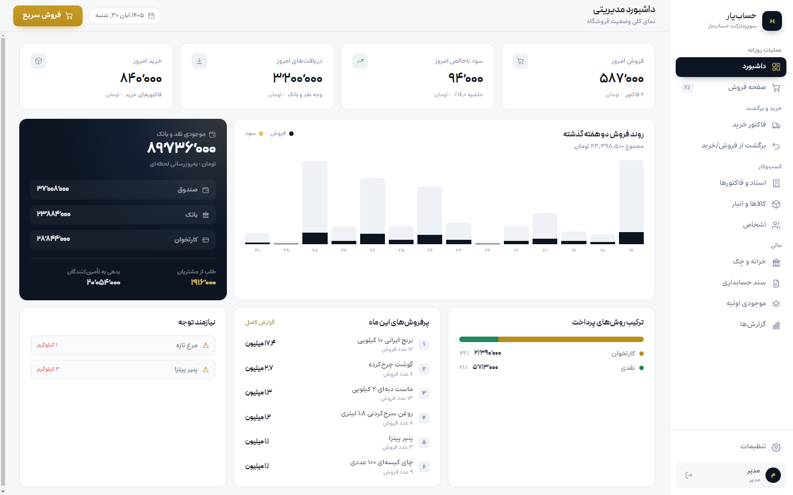

# حساب‌یار

**نرم‌افزار حسابداری فروشگاهی برای ویندوز** — سریع مثل صندوق فروش، دقیق مثل دفتر کل.

ساخته‌شده با Electron ۳۳ · SvelteKit ۲ · Svelte ۵ (runes) · Tailwind CSS ۴ · SQLite

</div>

---

حساب‌یار برای فروشگاه‌ها، سوپرمارکت‌ها و کسب‌وکارهای کوچکی نوشته شده که هم **سرعت ثبت فروش** برایشان مهم است و هم **درست بودن سود**. تمرکز اصلی پروژه روی شش مسئله‌ای است که معمولاً در نرم‌افزارهای ساده اشتباه حل می‌شوند:

| #   | مسئله                                     | راه‌حل در حساب‌یار                                                           |
| --- | ----------------------------------------- | ---------------------------------------------------------------------------- |
| ۱   | سود واقعی، نه «فروش منهای خرید»           | بهای تمام‌شده با **میانگین موزون متحرک** و قفل شدن بهای هر ردیف در لحظه فروش |
| ۲   | پرداخت ترکیبی (چند کارتخوان + نقد + نسیه) | چند ردیف پرداخت مستقل روی یک فاکتور                                          |
| ۳   | فروش به مشتری متفرقه                      | «مشتری متفرقه» پیش‌فرض است و هیچ حساب شخصی درگیر نمی‌شود                     |
| ۴   | اصلاح و ابطال بدون خراب کردن حساب‌ها      | سند معکوس + بازپخش گردش انبار + ثبت در گزارش رویدادها                        |
| ۵   | موجودی منفی                               | سیاست قابل تنظیم: مسدود / هشدار / آزاد — اعمال در لایه سرویس                 |
| ۶   | تفکیک سود از جریان نقدی                   | دو گزارش مستقل از دو منبع مستقل (تعهدی و نقدی)                               |

---

## فهرست

- [تصاویر برنامه](#تصاویر-برنامه)
- [نصب و اجرا](#نصب-و-اجرا)
- [ورود و کاربران](#ورود-و-کاربران)
- [صفحه فروش](#صفحه-فروش)
- [سند حسابداری دستی](#سند-حسابداری-دستی)
- [موجودی اولیه](#موجودی-اولیه)
- [واحد کالا](#واحد-کالا)
- [پشتیبان‌گیری و حذف داده‌ها](#پشتیبانگیری-و-حذف-دادهها)
- [معماری هسته](#معماری-هسته)
- [شش نکته‌ای که از ابتدا حل شده‌اند](#شش-نکتهای-که-از-ابتدا-حل-شدهاند)
- [کارایی](#کارایی-هیچ-فهرستی-یکجا-بارگذاری-نمیشود)
- [تاریخ شمسی](#تاریخ-شمسی)
- [ساختار پروژه](#ساختار-پروژه)
- [تست‌ها](#تستها)
- [ساخت نسخه نصبی ویندوز](#ساخت-نسخه-نصبی-ویندوز)
- [نقشه راه](#نقشه-راه)

---

## تصاویر برنامه

همه تصاویر از اجرای واقعی برنامه گرفته شده‌اند (پایگاه داده نمایشی با ۲۸ کالا، ۸۳ فاکتور فروش، خرید، برگشت، چک و هزینه).

### ورود و راه‌اندازی

| اجرای اول — اطلاعات کسب‌وکار                       | ورود با انتخاب کاربر از فهرست               |
| -------------------------------------------------- | ------------------------------------------- |
| 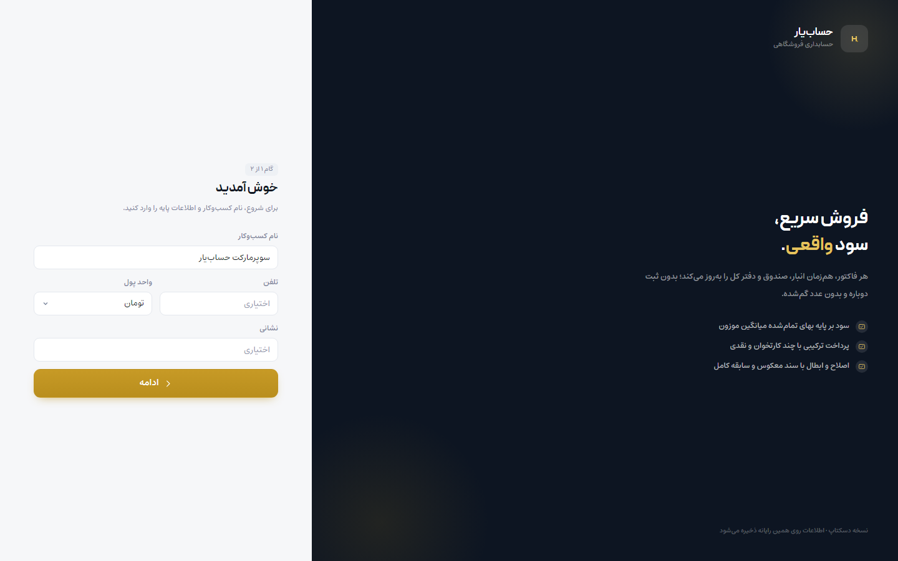 | 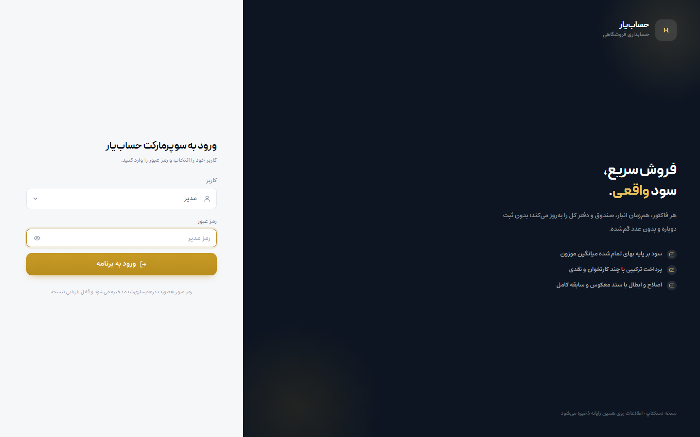 |

### داشبورد


فروش، سود و خرید امروز؛ روند ۱۴ روز؛ ترکیب روش‌های پرداخت؛ پرفروش‌های ماه؛ طلب از مشتریان و بدهی به تأمین‌کنندگان؛ کالاهای رو به اتمام.

### صفحه فروش

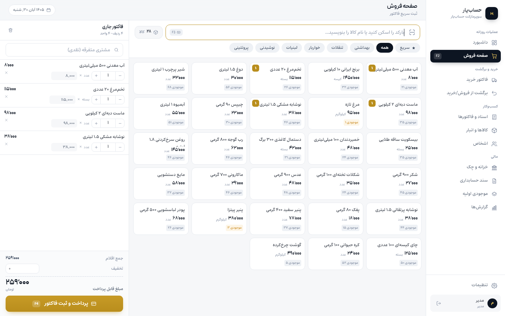

شبکه کالاها بخش اصلی صفحه است، «سریع» اولین دسته‌بندی و انتخاب پیش‌فرض، سبد خرید با قواعد واحد و هشدار موجودی.

### تسویه فاکتور

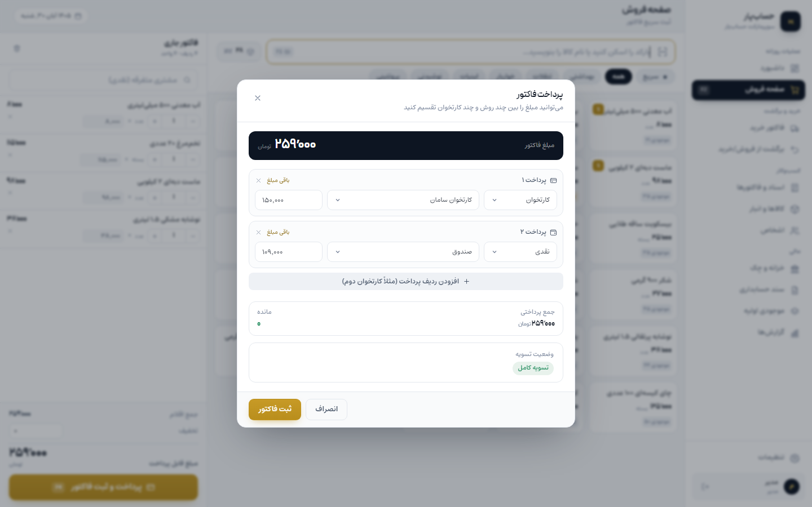

پرداخت ترکیبی: ۱۵۰٬۰۰۰ تومان کارتخوان سامان + ۱۰۹٬۰۰۰ تومان نقد. افزودن کارتخوان دوم و سوم در همان تسویه ممکن است و مانده به‌صورت زنده محاسبه می‌شود.

### اسناد و فاکتورها

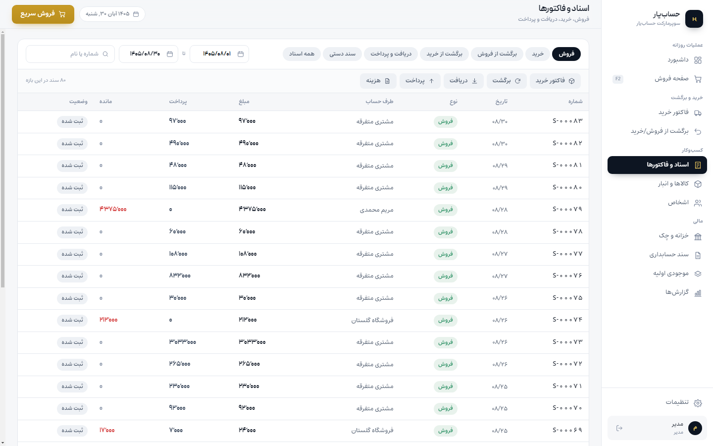

همه اسناد (فروش، خرید، برگشت، دریافت، پرداخت، هزینه، چک، سند دستی) در یک فهرست با فیلتر نوع، بازه تاریخ و جست‌وجوی متنی؛ صفحه‌بندی سمت سرور.

### خرید، برگشت، کالا، اشخاص، خزانه

| فاکتور خرید                                 | برگشت از فروش و خرید                         |
| ------------------------------------------- | -------------------------------------------- |
| 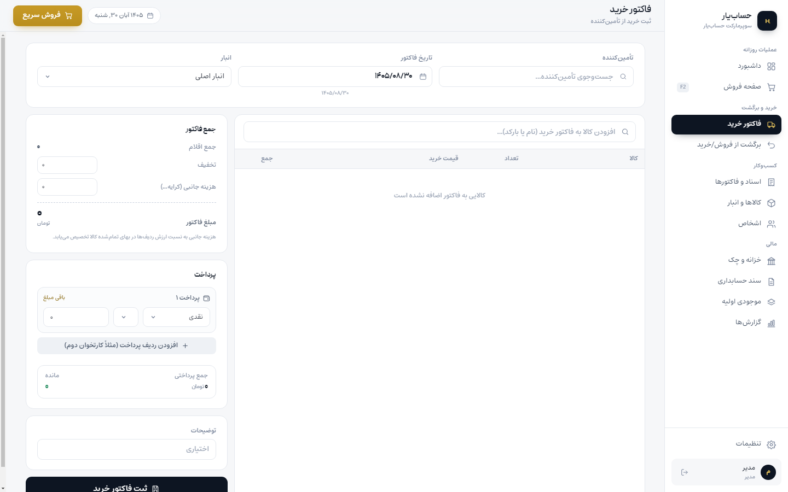  | 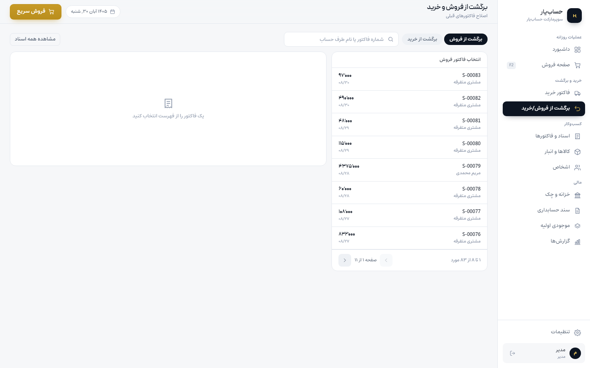    |
| **کالاها و انبار**                          | **اشخاص**                                    |
| 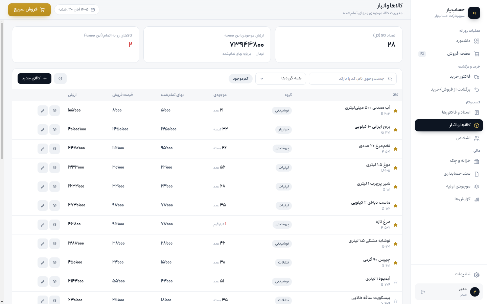 | 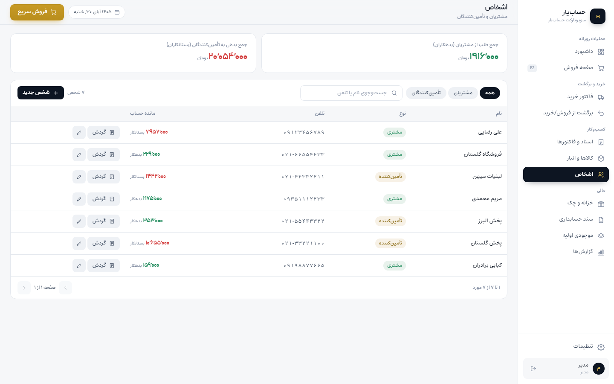    |
| **خزانه و چک**                              | **سند حسابداری دستی**                        |
| 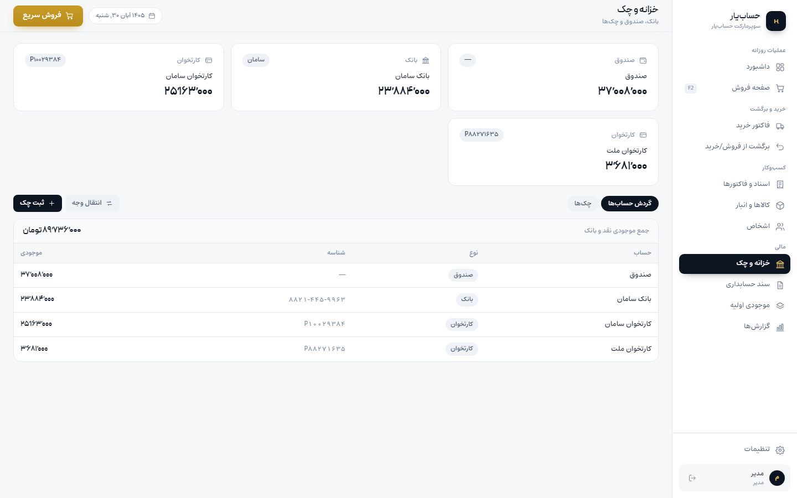  | 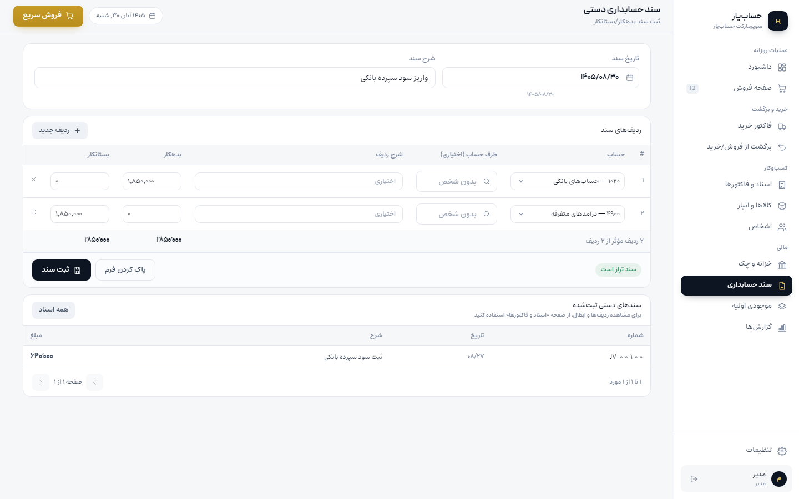 |

### موجودی اولیه، گزارش‌ها، تنظیمات

| موجودی اولیه                                     | گزارش سود و زیان                             |
| ------------------------------------------------ | -------------------------------------------- |
| 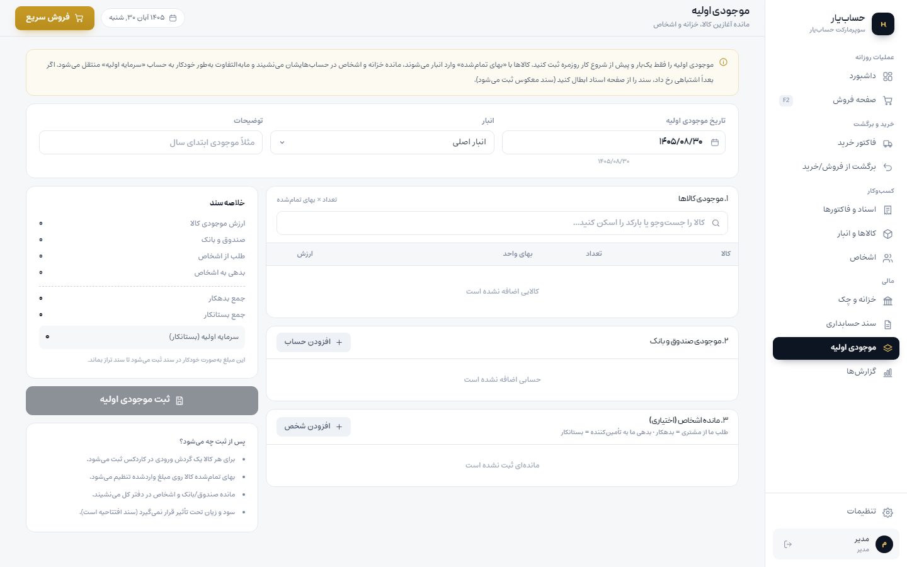 | 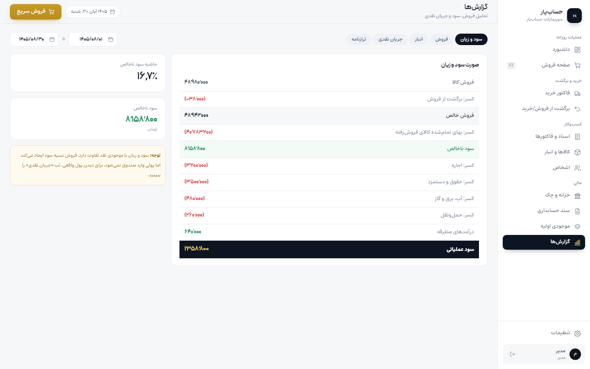 |

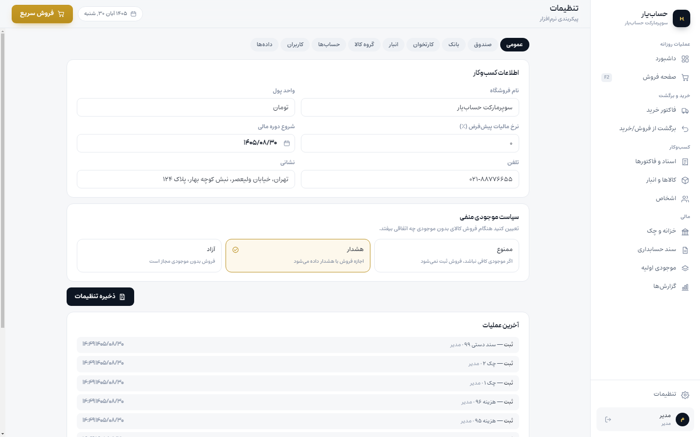

---

## نصب و اجرا

### نسخه نصبی ویندوز

از صفحه [Releases](../../releases) فایل `Hesabyar-Setup-x.y.z.exe` را دانلود و نصب کنید. برنامه به نسخه ۶۴ بیتی ویندوز ۱۰ یا جدیدتر نیاز دارد و به‌صورت مستقل (بدون نصب Node.js) اجرا می‌شود.

پایگاه داده در مسیر زیر ساخته می‌شود:

```
%APPDATA%\Hesabyar\hesabyar.db
```

### اجرا از سورس

```bash
npm install              # نصب وابستگی‌ها + کامپایل better-sqlite3 برای Electron
npm run electron:dev     # حالت توسعه (Vite + Electron با hot reload)
npm run electron:start   # ساخت و اجرای نسخه نهایی
npm run build            # فقط ساخت رابط کاربری
```

> نکته: در محیط‌هایی که متغیر `ELECTRON_RUN_AS_NODE=1` تنظیم شده، پیش از اجرا آن را `unset` کنید.

### ساخت نسخه نصبی

```bash
npm run dist:win         # خروجی در پوشه dist/
```

---

## ورود و کاربران

### اجرای اول

بار اول که برنامه باز می‌شود، صفحه راه‌اندازی نمایش داده می‌شود:

1. **اطلاعات کسب‌وکار:** نام فروشگاه (الزامی)، تلفن، نشانی و واحد پول
2. **رمز عبور مدیر:** با این رمز کاربر «مدیر» ساخته می‌شود و بلافاصله وارد برنامه می‌شوید

### اجراهای بعدی

صفحه ورود یک **فهرست کشویی** از نام کاربران فعال نشان می‌دهد؛ هیچ کاربری از پیش انتخاب نشده است. پس از انتخاب کاربر، فیلد رمز فعال و فوکوس می‌شود و `Enter` وارد می‌کند.

### نقش‌ها

| نقش           | دسترسی                                                                                                        |
| ------------- | ------------------------------------------------------------------------------------------------------------- |
| **مدیر**      | همه بخش‌ها: فروش، خرید، برگشت، اسناد، کالا، اشخاص، خزانه، سند دستی، موجودی اولیه، گزارش‌ها، تنظیمات و کاربران |
| **صندوق‌دار** | فقط **صفحه فروش**؛ بدون سایدبار و بدون هدر مدیریتی، مستقیم روی صندلی صندوق می‌نشیند                           |

صندوق‌دار اگر آدرس دیگری را هم باز کند، به صفحه فروش برگردانده می‌شود.

### امنیت

- رمز با **scrypt** و نمک تصادفی برای هر کاربر ذخیره می‌شود؛ رمز خام هیچ‌جا نوشته نمی‌شود
- پس از ۵ تلاش ناموفق، ورود آن کاربر ۶۰ ثانیه قفل می‌شود
- نشست فقط در حافظه فرایند اصلی است و با بستن برنامه پاک می‌شود
- کنترل دسترسی در `api.cjs` انجام می‌شود، نه در رابط کاربری؛ حتی فراخوانی مستقیم متدهای مدیریتی توسط صندوق‌دار رد می‌شود
- موجودی حساب‌ها از خروجی `bootstrap` برای صندوق‌دار حذف می‌شود
- نام کاربر جاری در `documents.created_by` و `audit_log` ثبت می‌شود
- مدیریت کاربران (افزودن، تغییر نقش، تغییر رمز، غیرفعال‌سازی، حذف) در **تنظیمات → کاربران**؛ آخرین مدیر فعال قابل حذف یا غیرفعال‌سازی نیست

---

## صفحه فروش

چیدمان دو ستونی: **شبکه کالاها بخش اصلی صفحه است** و «دسترسی سریع» به‌جای نوار جداگانه، **اولین دسته‌بندی** همین شبکه است.

- شبکه کالاها با ۲ تا ۵ ستون (بسته به عرض پنجره)، هر کارت ۹۲px با قیمت، واحد و موجودی رنگی
- نشان تعداد روی کارت‌هایی که در سبد هستند + دکمه «نمایش کالاهای بیشتر» (بارگذاری تدریجی)
- «سریع» **اولین دسته‌بندی و انتخاب پیش‌فرض** صفحه فروش است: فقط کالاهای ستاره‌دار را نشان می‌دهد؛ با «همه» یا هر دسته دیگر، فیلتر ستاره برداشته می‌شود
- جست‌وجو و اسکن بارکد با `Enter`، فیلتر گروه، فوکوس خودکار
- تغییر تعداد با قواعد واحد کالا (دکمه‌های +/− و ورودی دستی)، تغییر قیمت در همان سطر
- هشدار موجودی ناکافی در همان ردیف
- پرداخت ترکیبی با نمایش زنده مانده
- `F3` جست‌وجو · `F4` پرداخت · `Esc` بستن

---

## سند حسابداری دستی

صفحه «سند حسابداری» (`/journal`) برای ثبت‌های دستی: اصلاح مانده، انتقال بین حساب‌ها، ثبت هزینه‌های خاص.

- تاریخ شمسی + شرح سند + ردیف‌های نامحدود
- هر ردیف: حساب (گروه‌بندی‌شده)، طرف حساب اختیاری، شرح ردیف، بدهکار **یا** بستانکار
- پر کردن یک طرف، طرف دیگر همان ردیف را صفر می‌کند
- نمایش زنده جمع بدهکار/بستانکار، نشانگر «سند تراز است» و دکمه «پر کردن مغایرت»
- ثبت فقط وقتی ممکن است که سند تراز باشد؛ سرویس هم دوباره بررسی می‌کند (`postEntry` سند ناتراز را رد می‌کند)
- شماره‌گذاری خودکار با پیشوند `JV` و فهرست سندهای دستی ثبت‌شده در پایین صفحه

---

## موجودی اولیه

صفحه «موجودی اولیه» (`/opening`) مانده آغازین را در یک سند جمع می‌کند:

1. **کالاها** — جست‌وجو/اسکن، تعداد (با قواعد واحد) و بهای تمام‌شده هر واحد؛ برای هر کالا گردش ورودی در کاردکس ثبت و `avg_cost` تنظیم می‌شود.
2. **صندوق و بانک** — انتخاب خزانه و مبلغ؛ به حساب همان خزانه بدهکار می‌شود.
3. **اشخاص (اختیاری)** — طلب ما از مشتری (بدهکار) یا بدهی ما به تأمین‌کننده (بستانکار).

مابه‌التفاوت بدهکار و بستانکار به‌طور خودکار به حساب **سرمایه اولیه** می‌رود تا سند تراز بماند، و سود و زیان تحت تأثیر قرار نمی‌گیرد چون سند افتتاحیه است. اشتباه؟ سند را از صفحه اسناد ابطال کنید؛ سند معکوس ثبت می‌شود و موجودی/میانگین از تاریخچه بازسازی می‌شود.

---

## واحد کالا

واحد هر کالا در فرم کالا از یک فهرست انتخاب می‌شود و همان انتخاب، قواعد تعداد را در همه‌جا تعیین می‌کند:

| نوع واحد       | نمونه                       | ورودی تعداد                             |
| -------------- | --------------------------- | --------------------------------------- |
| شمردنی         | عدد، جفت، بسته، کارتن، کیسه | فقط عدد صحیح (ممیز تایپ‌شده حذف می‌شود) |
| وزنی/اندازه‌ای | کیلوگرم، گرم، لیتر، متر     | اعشاری تا ۳ رقم                         |

- منبع یگانه: `shared/units.json`؛ هم سرویس (`electron/services/units.cjs`) و هم رابط کاربری (`src/lib/domain/units.js`) از همان می‌خوانند.
- اعتبارسنجی سمت سرویس انجام می‌شود؛ بنابراین از هیچ مسیری (صفحه فروش، خرید، برگشت، موجودی اولیه) قابل دور زدن نیست.
- `QuantityInput` هنگام تایپ فقط کاراکترهای مجاز را نگه می‌دارد، ارقام فارسی را تبدیل می‌کند و در حالت اعشاری تا ۳ رقم اجازه می‌دهد.
- دکمه‌های +/− برای واحد شمردنی گام ۱ و برای واحد وزنی گام ۰٫۵ دارند.

---

## پشتیبان‌گیری و حذف داده‌ها

تنظیمات → تب **داده‌ها**. سه بخش دارد:

1. **پشتیبان‌گیری:** یک کپی کامل از پایگاه داده در مسیر دلخواه ذخیره می‌شود (با `wal_checkpoint` پیش از کپی، تا WAL هم در فایل باشد).
2. **وضعیت داده‌ها:** تعداد کالا، شخص، سند، سند حسابداری و کاربر.
3. **منطقه خطر:** دو عملیات غیرقابل بازگشت:

| عملیات                | چه چیزی پاک می‌شود                                                  | چه چیزی می‌ماند                                                                               |
| --------------------- | ------------------------------------------------------------------- | --------------------------------------------------------------------------------------------- |
| **حذف کامل اطلاعات**  | اسناد، اقلام، پرداخت‌ها، گردش انبار، دفتر کل، چک‌ها، گزارش رویدادها | کالاها، اشخاص، حساب‌ها، خزانه، انبار، کاربران و تنظیمات — موجودی کالاها صفر می‌شود            |
| **حذف کامل کسب‌وکار** | همه‌چیز، از جمله کاربران و تنظیمات                                  | فقط ساختار پایه (کدینگ حساب، انبار پیش‌فرض، صندوق)؛ برنامه به صفحه راه‌اندازی اولیه برمی‌گردد |

قاعده سخت‌گیرانه: **تا نسخه پشتیبان گرفته نشود، دکمه‌های حذف غیرفعال‌اند.** علاوه بر آن:

- باید واژه «حذف» تایپ شود؛
- مسیر فایل پشتیبان باید وجود داشته باشد، حجمش معقول باشد و امضای `SQLite format 3` را داشته باشد؛
- این بررسی‌ها در `maintenance.cjs` (فرایند اصلی) تکرار می‌شوند، پس از رابط کاربری قابل دور زدن نیستند؛
- پس از «حذف کامل کسب‌وکار»، نشست بسته و برنامه به حالت راه‌اندازی برمی‌گردد.

---

## معماری هسته

اصل حاکم: **هر عملیات یک بار توسط کاربر ثبت می‌شود و همه آثار آن به‌صورت اتمیک (در یک تراکنش) اعمال می‌گردد.**

هر سند تجاری (فروش، خرید، دریافت، هزینه، چک، ...) سه اثر هم‌زمان دارد:

1. **رکورد سند** در `documents` + `document_lines` + `document_payments`
2. **گردش انبار** در `stock_moves` (منبع حقیقت موجودی و کاردکس)
3. **سند حسابداری دوطرفه** در `journal_entries` + `journal_lines`

`postEntry()` پیش از ثبت، تراز سند را بررسی می‌کند؛ اگر بدهکار و بستانکار برابر نباشند، عملیات با خطا برمی‌گردد. در نتیجه دفتر همیشه تراز است و هیچ عددی «گم» نمی‌شود.

### کدینگ ساده حساب‌ها

بدون درخت حساب پیچیده. گروه‌های ثابت: صندوق، بانک، کارتخوان، اشخاص، موجودی کالا، چک‌های دریافتنی، بدهی‌ها، مالیات، سرمایه، درآمد، هزینه.

- هر شخص **یک حساب** دارد؛ مانده مثبت = بدهکار (طلب ما)، منفی = بستانکار (بدهی ما). همین یک قاعده، پیچیدگی تفکیک «حساب‌های دریافتنی/پرداختنی» را حذف می‌کند.
- هر خزانه (صندوق/بانک/کارتخوان) یک حساب دارد.
- هر نوع هزینه/درآمد یک حساب دارد و کاربر می‌تواند حساب جدید بسازد.

---

## شش نکته‌ای که از ابتدا حل شده‌اند

### ۱) محاسبه سود واقعی — میانگین موزون متحرک

بهای تمام‌شده هر کالا در `products.avg_cost` نگه داشته می‌شود:

```
ورود:  میانگین جدید = (موجودی قبلی × میانگین قبلی + تعداد × بهای ورود) ÷ موجودی جدید
خروج:  میانگین تغییر نمی‌کند؛ بهای تمام‌شده = تعداد × میانگین جاری
```

هزینه‌های جانبی خرید (کرایه و ...) به نسبت ارزش هر ردیف در بهای ورود تخصیص می‌یابد، پس در سود واقعی اثر می‌گذارد.

در لحظه فروش، `unit_cost` و `cost_total` در ردیف فاکتور **قفل می‌شوند** (snapshot). بنابراین تغییر قیمت‌ها در آینده، سود فاکتورهای گذشته را تغییر نمی‌دهد.

`profit = (فروش خالص − تخفیف) − بهای تمام‌شده`

### ۲) فروش با پرداخت ترکیبی

هر سند می‌تواند چند ردیف پرداخت داشته باشد (`document_payments`): نقدی، کارتخوان، کارت به کارت، انتقال بانکی، چک، نسیه.

در صفحه فروش، مبلغ فاکتور بین روش‌ها تقسیم می‌شود، «باقی مبلغ» با یک کلیک پر می‌شود و مانده به‌صورت خودکار به حساب مشتری می‌رود. در سند حسابداری هم هر روش به حساب خزانه خودش بدهکار می‌شود.

### ۳) فروش با مشتری عمومی

`party_id` اختیاری است. اگر فاکتور کامل تسویه شود، هیچ حساب شخصی درگیر نمی‌شود (`party_name = 'مشتری متفرقه'`).

تنها استثنا: اگر مبلغی نسیه بماند و مشتری انتخاب نشده باشد، سیستم با پیام روشن جلوی ثبت را می‌گیرد — چون طلب بدون بدهکار قابل پیگیری نیست.

### ۴) اصلاح و ابطال اسناد

هیچ سندی حذف نمی‌شود:

- **ابطال:** سند معکوس در دفتر روزنامه ثبت می‌شود + گردش معکوس انبار + بازسازی موجودی و میانگین از تاریخچه + وضعیت `voided` + ثبت در `audit_log`.
- **اصلاح:** سند قبلی باطل و سند جدید با `ref_id` به آن ارجاع داده می‌شود؛ زنجیره سابقه حفظ می‌شود.

`recomputeProduct()` کل گردش یک کالا را از ابتدا بازپخش می‌کند تا پس از هر ابطال، موجودی و میانگین قطعاً سازگار بمانند.

### ۵) مدیریت موجودی منفی

تنظیم `stock_policy` سه حالت دارد:

| حالت    | رفتار                       |
| ------- | --------------------------- |
| `block` | فروش بدون موجودی کافی ممنوع |
| `warn`  | مجاز با هشدار (پیش‌فرض)     |
| `allow` | آزاد                        |

بررسی در لایه سرویس انجام می‌شود، نه در UI؛ پس از هر مسیری (صفحه فروش، API، وارد کردن داده) قابل دور زدن نیست.

### ۶) تفکیک سود از جریان نقدی

دو گزارش کاملاً مستقل از دو منبع متفاوت:

- **سود و زیان** → از حساب‌های درآمد/هزینه در دفتر روزنامه (مبنای تعهدی). فروش نسیه سود می‌سازد حتی اگر پولی وارد صندوق نشده باشد.
- **جریان نقدی** → فقط از حساب‌های صندوق/بانک/کارتخوان.

در داشبورد هم این دو کنار هم ولی جدا نمایش داده می‌شوند تا کاربر اشتباه نگیرد.

---

## کارایی: هیچ فهرستی یک‌جا بارگذاری نمی‌شود

| بخش                      | راهکار                                                 |
| ------------------------ | ------------------------------------------------------ |
| انتخاب مشتری/تأمین‌کننده | جست‌وجوی سروری با تأخیر ۲۰۰ms، پیش‌فرض «مشتری متفرقه»  |
| جست‌وجوی کالا            | `products.search` با محدودیت ۱۰ ردیف + بارکد           |
| فهرست کالاها             | صفحه‌بندی سمت سرور (۲۵ ردیف) + فیلتر گروه و کم‌موجود   |
| فهرست اشخاص              | صفحه‌بندی سمت سرور (۲۵ ردیف) + جست‌وجو و نوع           |
| اسناد و فاکتورها         | صفحه‌بندی سمت سرور (۲۵ ردیف) + فیلتر نوع/بازه/متن      |
| داده‌های سراسری          | فقط تنظیمات، گروه‌ها، خزانه‌ها، انبارها و کالاهای سریع |

منطق صفحه‌بندی در SQL انجام می‌شود (`LIMIT/OFFSET` + `COUNT`)، بنابراین با ۱۰۰٬۰۰۰ کالا هم سرعت صفحه ثابت می‌ماند.

---

## تاریخ شمسی

- نمایش همه تاریخ‌ها با تقویم جلالی و ارقام فارسی
- ورودی تاریخ (`DateInput`) مقدار شمسی می‌گیرد و ISO میلادی تحویل می‌دهد؛ با کلیدهای بالا/پایین یک روز جابه‌جا می‌شود و ورودی نامعتبر را با قاب قرمز نشان می‌دهد
- الگوریتم تبدیل در `src/lib/jalali.js` بدون وابستگی خارجی پیاده شده و با ۲۲۰۰ روز رفت‌وبرگشت تست می‌شود
- بازه‌های پیش‌فرض گزارش‌ها بر مبنای **ماه شمسی** است، نه ماه میلادی

---

## ساختار پروژه

```
shared/
  units.json            منبع یگانه واحدهای کالا (عدد، جفت، کیلوگرم…) برای فرایند اصلی و رابط کاربری
electron/
  main.cjs              پنجره، پروتکل app://، IPC، پشتیبان‌گیری
  preload.cjs           پل امن (contextBridge)
  db/
    schema.cjs          اسکیمای SQLite
    index.cjs           اتصال، مهاجرت، داده اولیه
  services/
    ledger.cjs          دفتر روزنامه دوطرفه، سند معکوس، مانده حساب
    inventory.cjs       میانگین موزون، گردش انبار، بازسازی موجودی
    documents.cjs       ساخت اسناد (فروش، خرید، برگشت، دریافت، چک، سند دستی، موجودی اولیه)
    units.cjs           اعتبارسنجی تعداد بر اساس واحد کالا
    auth.cjs            راه‌اندازی اولیه، ورود، نشست، مدیریت کاربران و نقش‌ها
    password.cjs        درهم‌سازی scrypt با نمک تصادفی
    actor.cjs           کاربر جاری برای created_by و audit_log
    maintenance.cjs     پشتیبان اجباری، حذف کامل اطلاعات و کسب‌وکار
    catalog.cjs         تعاریف پایه: کالا، گروه، اشخاص، خزانه، انبار، تنظیمات
    reports.cjs         داشبورد، سود و زیان، جریان نقدی، کاردکس، ترازنامه، فهرست صفحه‌بندی‌شده اسناد
    validate.cjs        اعتبارسنجی ورودی‌ها (ارقام فارسی، متن، شناسه، تاریخ)
    errors.cjs          خطاهای دامنه با کد
    api.cjs             نقشه متدها برای IPC + کنترل دسترسی بر اساس نقش
src/
  routes/               داشبورد، pos، purchases، returns، invoices، products، parties،
                        treasury، journal، opening، reports، settings
  lib/
    domain/             منطق خالص و قابل تست: cart.js (سبد اقلام)، payment.js (پرداخت ترکیبی)،
                        units.js (قواعد واحد)
    components/         Icon، Modal، NumInput، QuantityInput، DateInput، PartyPicker،
                        PaymentEditor، ProductSearch، Pagination، Toasts، LoginScreen، settings/*
    auth.svelte.js      وضعیت نشست، انتخاب کاربر و خروج
    jalali.js           تبدیل و اعتبارسنجی تاریخ شمسی
    format.js           قالب‌بندی اعداد/تاریخ، برچسب‌ها
    session.svelte.js   وضعیت سراسری سبک (بدون فهرست‌های سنگین)
tests/
  domain.test.js        ۳۶ تست واحد (Node test runner)
scripts/
  test-core.cjs         ۷۰ سنجه هسته حسابداری روی پایگاه داده موقت
  smoke.cjs             ۵۲ بررسی رابط کاربری (بدون اسکرین‌شات)
  shot.cjs              تولید اسکرین‌شات‌های همین README
  demo-data.cjs         داده نمایشی تکرارپذیر برای اسکرین‌شات‌ها
docs/
  screenshots/          تصاویر مستندات
```

---

## تست‌ها

```bash
npm run test        # تست‌های واحد + هسته حسابداری
npm run test:unit   # ۳۶ تست منطق دامنه، واحد کالا و تقویم شمسی (Node، بدون Electron)
npm run test:core   # ۷۰ سنجه روی پایگاه داده موقت (Electron) — شامل کاربران، دسترسی و حذف امن
npm run test:ui     # ۵۲ بررسی رابط کاربری روی build واقعی، بدون اسکرین‌شات
npm run verify      # زنجیره کامل: lint → unit → core → build → ui
npm run lint        # ESLint
npm run format      # Prettier
```

`test:core` فقط از مسیرهای رسمی سرویس‌ها استفاده می‌کند و این موارد را می‌سنجد: خام بودن کسب‌وکار تازه، تراز بودن دفتر پس از هر عملیات، درستی میانگین موزون، بازگشت کامل اثر ابطال، تفکیک سود از جریان نقدی، قواعد واحد کالا، دسترسی نقش‌ها و ماتریس حذف داده (بدون پشتیبان / تأیید نادرست / فایل جعلی).

`test:ui` راه‌اندازی اولیه، ورود مدیر و صندوق‌دار از فهرست کشویی، همه مسیرها، ثبت واقعی «سند دستی» و «موجودی اولیه» و منطقه خطر را بررسی می‌کند و نتیجه را فقط به‌صورت لاگ می‌دهد.

برای بازتولید تصاویر مستندات:

```bash
npm run shots       # ساخت build + اجرا روی پایگاه داده موقت و تولید docs/screenshots
```

---

## ساخت نسخه نصبی ویندوز

نسخه نصبی با `electron-builder` ساخته می‌شود (NSIS، معماری x64).

### خودکار — GitHub Actions

با push یک تگ نسخه، گردش‌کار `.github/workflows/release.yml` روی `windows-latest` اجرا می‌شود، تست‌ها را می‌گذراند، فایل نصبی را می‌سازد و آن را به Release همان تگ پیوست می‌کند:

```bash
git tag v1.0.0
git push origin v1.0.0
```

پس از پایان اجرا، فایل `Hesabyar-Setup-1.0.0.exe` در صفحه Releases قابل دانلود است.

### دستی

```bash
npm run dist:win
```

خروجی در `dist/` قرار می‌گیرد.

---

## نقشه راه

**فاز ۱ (پیاده‌شده):** اطلاعات پایه، خرید و فروش، برگشت‌ها، انبار، دریافت/پرداخت، صندوق و بانک، درآمد و هزینه، موجودی اولیه، سند حسابداری دستی، واحد کالا، کاربران و نقش‌ها (مدیر/صندوق‌دار)، داشبورد، گزارش‌های پایه، صفحه فروش سریع، تاریخ شمسی، صفحه‌بندی و جست‌وجوی سروری، تست واحد/هسته/رابط کاربری، لینتر و فرمتر، بسته‌بندی و انتشار خودکار.

**فاز ۲:** چاپ فاکتور و رسید حرارتی، مغایرت‌گیری بانکی، بستن دوره مالی، خروجی Excel، ثبت رویداد کامل‌تر عملیات کاربران.

**فاز ۳:** چند انبار، چند شعبه، اتصال به سامانه مؤدیان/مالیات، گزارش‌های تحلیلی، اتصال مستقیم به PSP.
